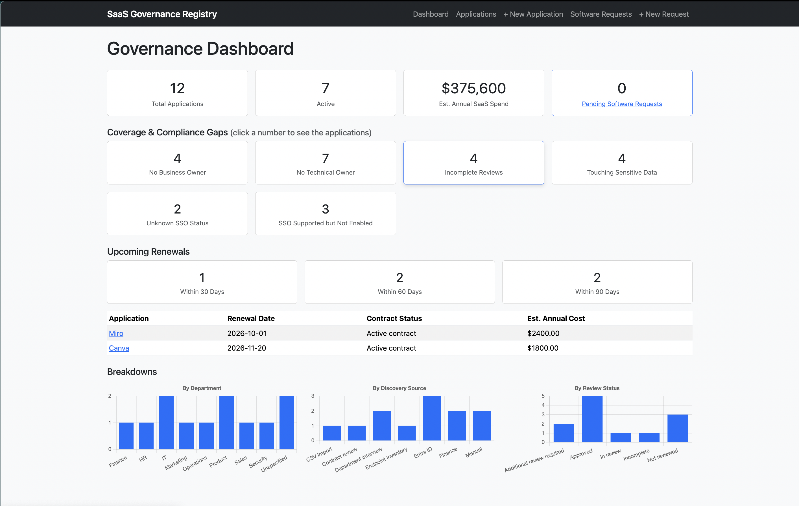
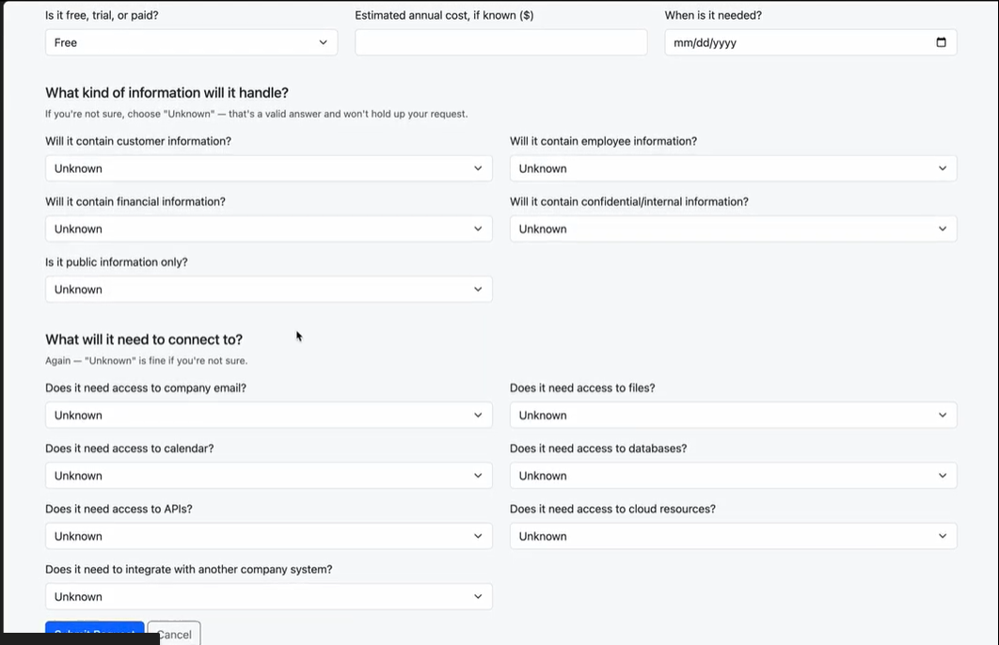
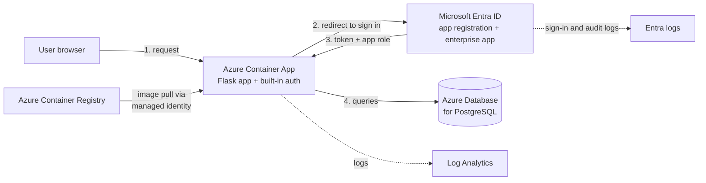
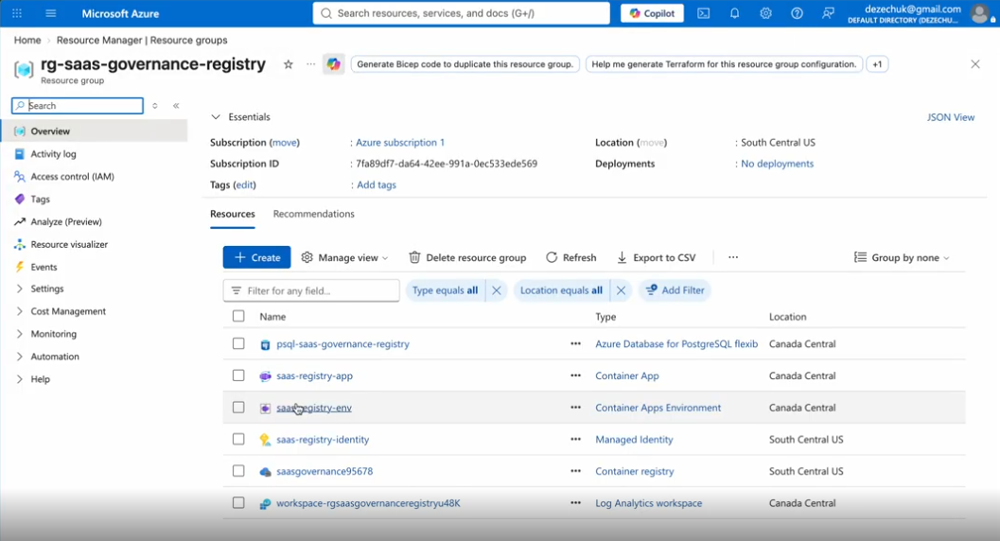
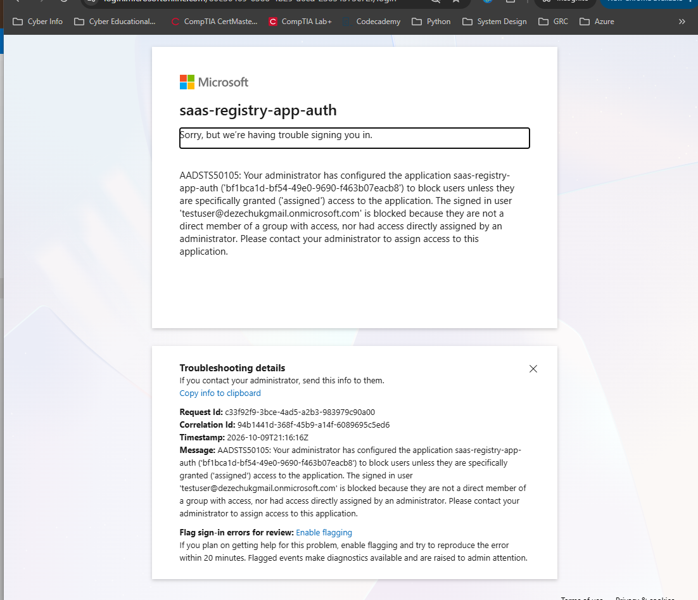
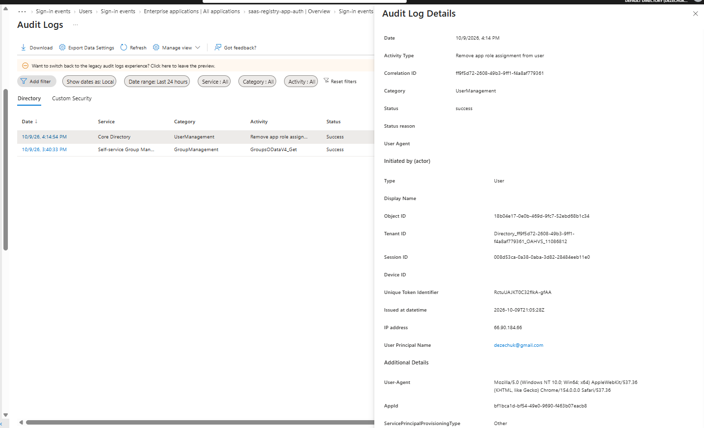
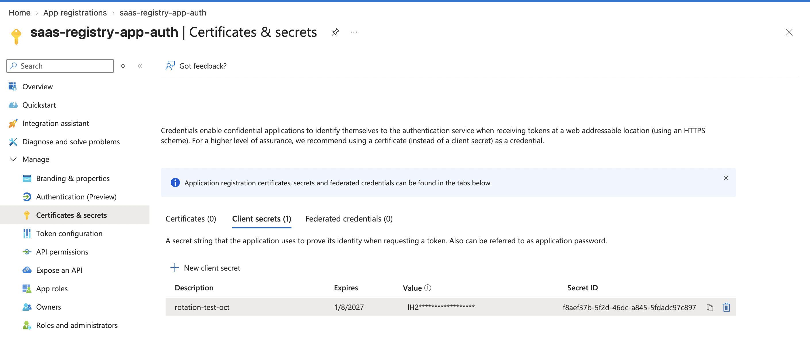

# SaaS Application Governance Registry: Business Case and Walkthrough

> A portfolio project showing how I'd bring order to SaaS adoption: a registry of applications, a review workflow for new requests, and identity controls in Microsoft Entra ID.
> This was more about me showing what type of information I would be focused on accumulating to get a handle on Saas governance and Shadow IT. From a tool perspective, this could all be captured and stored using Microsoft tools that are already available: Sharepoint Lists, Forms, Power Automations to change statuses. That is a part of solving this problem. A huge part of getting control of shadow IT is RELATIONAL. Being a trusted collaborator where colleagues are comfortable sharing their workflows and are not worried about their work being impeded because their favorite tool is "not secure" or redundant. Truly educating colleagues around the security risks of IT not being able to monitor and track where the company data is going. This project also worked as a study resource for SC-300 prep. Deploying the application in Azure and setting up the identity mechanism, app registration and configuring enterprise application settings are extensive topics for the certification. Lastly, I continued to work with Python and Flask, deepening my familiarity with the coding stack.

---
> **Technical code and setup:** [saas-governance-registry](https://github.com/aezechuk/saas-governance-registry)

---
> **Status:** deployed on Azure during the build, then taken down to avoid cost. Evidence is in the screenshots and video below.

**Video walkthrough:** `[add link here]` (about 6 minutes)

---

## 1. The Business Problem

Teams adopt SaaS tools faster than IT can track them. The usual result:

- Nobody has one list of which applications exist, who owns them, or what data they touch.
- New tool requests arrive by email or chat, with no consistent review.
- Access is granted ad hoc and rarely removed when someone leaves, and there's a lack of visibility into that access.
- Audit and security questions ("who can access this?", "who removed that access?") take days to answer.

**What this project answers:** a single registry of applications with ownership and data classification, an intake and review workflow for new requests, a dashboard that shows where the gaps are, and identity controls that make access explicit and auditable.

> **Dashboard with governance gap counts**
> 

> **Intake form for a new software request**
> 

---

## 2. Architecture

**In plain words**
- The app runs as a container on Azure Container Apps. Container Apps' built-in authentication handles sign-in, so the app code never touches passwords.
- Entra ID decides who may sign in. The enterprise application requires assignment, and users carry one of three app roles: Requester, Reviewer, Administrator.
- The container image comes from a private registry. A managed identity with pull-only permission fetches it, so no registry password exists.
- Data lives in a managed PostgreSQL server. Schema changes go through Alembic migrations.

> **Azure resource group showing the resources**
> 

> **Container App running, health check healthy**
> ``

---

## 3. What I Did

### Built and deployed
- Built the registry, intake workflow and dashboard (Flask, SQLAlchemy), with tests.
- Moved from SQLite to PostgreSQL with migrations; containerized with a multi-stage Docker build running as a non-root user.
- Deployed to Azure Container Apps with secrets held as platform secrets, not in the image.
- Pulled images with a managed identity limited to pull access on a single registry.

### Identity administration in Entra ID
- Registered the application, required sign-in, and set **Assignment required** so only assigned users get in.
- Created app roles (Requester, Reviewer, Administrator), assigned them to users, and verified the roles arrive as claims in the token.
- Found and fixed a duplicate role assignment, and granted admin consent where a user hit "Need admin approval".

> **Enterprise application, users and groups with roles**
> ``

### Testing how it fails, using the logs
| Scenario | What happened | How I knew |
|---|---|---|
| User not assigned | Blocked at Entra, error **50105** | Sign-in log |
| Enterprise app disabled | Error `____` | Sign-in log |
| Wrong redirect URI | Error `____` | Sign-in log |
| Account disabled, fresh sign-in | Blocked ("account has been locked") | Sign-in log, code `____` |
| Account disabled and sessions revoked, existing tab | **Still worked** | Observed |
| Client secret rotated | New secret added, app updated, tested, old deleted | Observed |

> **Sign-in log, 50105 failure detail**
> 

> **Audit log entries (role assignment, consent)**
> 

> 📸 **Secrets list after rotation**
> 

### What I learned
- **Disabling an account is not offboarding.** It blocked new sign-ins, but an open app session kept working after the account was disabled and its sessions revoked, because the app issues its own session cookie. Closing that gap takes short session lifetimes, per-request status checks, automated deprovisioning, or apps that support Continuous Access Evaluation.
- **Sign-in logs and audit logs answer different questions.** "Why can't they log in?" starts in sign-in logs (error code and failure reason). "Who changed their access?" starts in audit logs.
- **Security defaults** was on by default in the tenant. It must be turned off (and the tenant needs a P1 or P2 licence) before Conditional Access policies can be used.
- **Authentication, authorization and ownership are three layers.** Entra proves who you are and which role you hold. The application decides what a role may do and whose records you may see.
- **Rotate secrets in the right order:** add the new one, update the app, test, then delete the old one.
- A platform gap I hit: the `/.auth/me` endpoint isn't available on Container Apps, so I read identity from the request header instead.

> **The "account has been locked" screen**
> 

---

## 4. What I Would Do Differently in Production

| Area | In this project | In production |
|---|---|---|
| Role enforcement | Roles are assigned and arrive as claims, but the app does not yet restrict actions by role | Enforce roles in code on every route, plus row-level ownership checks |
| Offboarding | Disable and revoke; app session survives | Short session lifetime, per-request user status check, automated deprovisioning (SCIM), CAE where supported |
| Secrets | Client secret stored as a Container App secret, rotated by hand | Key Vault with managed identity access; certificate or federated credential in place of a secret; rotation alerts before expiry |
| Database network | Public endpoint with firewall rules | Private endpoint and VNet integration; no public access |
| Monitoring | Container and Entra logs only | Application Insights through OpenTelemetry; alerts on failed sign-ins and spikes in 50105 |
| Access policy | Assignment required and Security defaults | Conditional Access (MFA, device and location rules), group-based role assignment, periodic access reviews |
| Delivery | Manual image builds and deploys | CI/CD with GitHub Actions and OIDC federated credentials, image scanning, no stored cloud credentials |
| Infrastructure | Created by hand and CLI | Terraform, so the environment can be rebuilt and reviewed as code |
| Data protection | Basic backups | Defined retention, geo-redundant backup, tested restore |
| Logging retention | Entra free-tier retention (about 7 days) | Export sign-in and audit logs to Log Analytics or a SIEM for long-term retention |

**Things I paused on:** CSV discovery import, AI-assisted review, and retrieval-based governance guidance. I prioritized identity administration over additional features because that is the work I'm preparing for.

---

## Frameworks Referenced

OWASP Top 10 (Web, API, LLM), MITRE ATT&CK and ATLAS, NIST SP 800-53 and AI RMF, ISO 42001, EU AI Act. Control mapping lives in the technical repo (`controls-mapping.md`).

Please note that I am well aware there isn't much screenshot hygiene going on. This was a temporary account used solely for this project and has since been completely torn down.
